# 🛡️ Awesome Cloud Workload Protection (CWPP) & CNAPP Ecosystem

**A curated catalog of enterprise SaaS products, CNAPP suites, and battle-tested open-source GitHub projects for Cloud Workload Protection (CWPP), eBPF-driven runtime security, agentless vulnerability scanning, and Kubernetes compliance hardening.** 🚀

Cloud Workload Protection Platforms (CWPP) secure compute workloads across multi-cloud environments—including Virtual Machines (VMs), Docker containers, Kubernetes (K8s) clusters, and serverless functions (AWS Lambda, Azure Functions, Google Cloud Run). They provide real-time runtime protection, vulnerability scanning, system call tracing, compliance enforcement, and threat detection. 🔐

---

## 📑 Table of Contents

- [📊 Sector Overview & Market Dynamics](#-sector-overview--market-dynamics)
- [🏢 SaaS & Enterprise CWPP Platforms](#-saas--enterprise-cwpp-platforms)
- [💻 Open-Source CWPP & Cloud Security Projects](#-open-source-cwpp--cloud-security-projects)
- [⚖️ Comparison Matrix: SaaS vs Open-Source](#️-comparison-matrix-saas-vs-open-source)
- [🤝 How to Contribute](#-how-to-contribute)
- [📈 Star History](#-star-history)
- [💖 Support](#-support)
- [📜 License & Disclaimer](#-license--disclaimer)

---

## 📊 Sector Overview & Market Dynamics

The global **Cloud Workload Protection Platform (CWPP) and Cloud-Native Application Protection Platform (CNAPP)** market was estimated at **$21.4 billion in 2025** and is projected to expand to **$42.95 billion by 2032**, demonstrating a compound annual growth rate (**CAGR**) of **10.6%**. 📈

The sector exhibits **moderate concentration with intense, shifting competition** rather than a "winner-take-all" outcome. 🌐 Hyperscalers and multi-billion-dollar enterprise cybersecurity leaders (Microsoft Defender for Cloud, Palo Alto Networks Prisma Cloud, CrowdStrike Falcon, Fortinet) dominate broad enterprise deployments, but nimble pure-play innovators (such as Wiz, which achieved a landmark $32 billion valuation) continue to disrupt standard workflows through agentless side-scanning. Concurrently, high enterprise per-workload fees have created sustained demand for transparent open-source stacks—engineering teams routinely assemble production-grade CWPP solutions by pairing CNCF kernel-level runtime engines (**Falco**, **Tetragon**, **Tracee**) with vulnerability and posture scanners (**Trivy**, **Prowler**, **Kube-bench**). ⚡

---

## 🏢 SaaS & Enterprise CWPP Platforms

The table below lists top enterprise CWPP and converged CNAPP SaaS solutions. Companies are sorted in **descending order by company scale** (Market Capitalization for public corporations or latest valuation / enterprise value for private/acquired entities). 💼

| Product | Company Valuation / Revenue | Description | Pricing (Starting Tier) | Free Tier / Free Trial Limits |
|:---|:---|:---|:---|:---|
| **[Microsoft Defender for Cloud](https://azure.microsoft.com/en-us/pricing/details/defender-for-cloud/)** | **~$3.1 Trillion** market cap (Microsoft) / **$245B+** rev | ☁️ Native multi-cloud CNAPP providing CSPM, CIEM, and workload protection for virtual servers, containers, databases, storage, and serverless APIs across Azure, AWS, and GCP. | Defender for Servers Plan 1: **$4.906/server/month**; Plan 2: **$14.60/server/month**; Containers: **$6.8693/vCore/month**; SQL: **$15/instance/month** | **Free forever foundational CSPM** included with Azure subscription; **30-day free trial** with $200 Azure credits for advanced workload protection tiers |
| **[Palo Alto Prisma Cloud](https://www.paloaltonetworks.com/prisma/cloud)** | **~$240 Billion** market cap (PANW) / **$11.48B** rev | 🛡️ Comprehensive CNAPP integrating vulnerability management, CWPP host and container security, web application and API security (WAAS), and compliance monitoring. | Credit-based licensing starting at **$3,600/year** for base compute/workload credit packs (private offers available via AWS/Azure Marketplace) | **30-day free trial** with full access to Prisma Cloud Enterprise CNAPP features across up to 50 cloud accounts |
| **[CrowdStrike Falcon Cloud Security](https://www.crowdstrike.com/)** | **~$118 Billion** market cap (CRWD) / **$3.95B** rev | 🦅 Unified agent and agentless cloud workload protection extending Falcon endpoint detection and response (EDR/XDR) to Linux/Windows VMs, containers, and Kubernetes. | Falcon Cloud Workload Protection starting at **$233.99/license** (3-year term via authorized distributors/CDW) or custom AWS Marketplace consumption contracts | **15-day free trial** for Falcon Cloud Security with pre-configured detection policies and full sensor workload telemetry |
| **[Fortinet Lacework (FortiCNAPP)](https://www.lacework.com/)** | **~$59 Billion** market cap (Fortinet) / **$6.80B** rev | 🧠 Behavioral anomaly detection platform powered by Polygraph machine learning engine, now integrated into the Fortinet Security Fabric for cloud workloads. | Entry tier starting at **$30,000/year** (custom workload licensing via AWS Marketplace private offers) | **14-day free trial** with automated cloud posture assessment and real-time workload threat monitoring |
| **[Wiz](https://www.wiz.io/)** | **$32 Billion** valuation (acquired by Alphabet) / **$1B+** ARR | 🧙‍♂️ Market-leading agentless CNAPP utilizing multi-cloud snapshot side-scanning and interactive risk graph analysis to correlate workload vulnerabilities with misconfigurations. | Wiz Essential starting tier: **$24,000/year** (covering up to 100 workloads, ~$240/workload/year); Advanced tier: **$38,000/year** via AWS Marketplace | **14-day free trial** (POC evaluation) granting full access to agentless cloud inventory scanning and visual risk graph analysis |
| **[Trend Micro Cloud One](https://www.trendmicro.com/)** | **~$5.7 Billion** market cap (TYO: 4704) / **$1.84B** rev | 🌐 Modular cloud workload protection platform featuring host and container security, virtual patching, intrusion prevention (IPS), and integrity monitoring. | Pay-as-you-go host protection starting at **$0.06/host/hour** (approx. **$43.80/host/month**) or **$385.03/device/year** (government CDW contract schedule) | **30-day free trial** providing full feature access across all Trend Micro Cloud One protection modules without initial credit card requirement |
| **[Tenable Cloud Security](https://www.tenable.com/cloud-security)** | **~$4.5 Billion** market cap (TENB) / **$1.0B** rev | 🔎 Context-aware CNAPP combining workload vulnerability scanning, identity entitlement management (CIEM), infrastructure as code (IaC) security, and CSPM. | Tenable Cloud Security base subscription starting at **$18,000/year** for 300 resource workloads via AWS Marketplace | **30-day free trial** (or 7-day deep-dive assessment) with full multi-cloud asset discovery and vulnerability reporting |
| **[Sysdig Secure](https://sysdig.com/)** | **$2.5 Billion** valuation / **~$280 Million** ARR | ⚡ Runtime security and posture management engine built on Falco eBPF telemetry, delivering sub-second container and host intrusion detection and Drift Control. | AWS Marketplace starting tier: **$72/host/month** (subject to 20-host minimum commitment, equating to **$17,280/year**) | **30-day free trial** with complete access to runtime threat detection, container image scanning, and compliance audits |
| **[Druva Cloud Workload Protection](https://www.druva.com/)** | **$2.0 Billion** valuation / **~$200 Million** ARR | 💾 Autonomous cyber resilience and data protection suite securing AWS/Azure virtual instances, enterprise databases, and unstructured cloud storage against ransomware. | Druva Cloud Platform starting at **$2.50/GB/month** (or ~$25/workload/month for AWS EC2 snapshot backup and anomaly scanning) | **30-day free trial** with 100 GB backup storage allowance and live cloud workload anomaly scans |
| **[Orca Security](https://orca.security/)** | **$1.8 Billion** valuation / **~$65 Million** ARR | 🐋 Pioneer in agentless SideScanning technology, analyzing cloud VM storage snapshots and APIs out-of-band to detect OS vulnerabilities, malware, and secrets. | AWS Marketplace published Small-Medium tier starting at **$124,440/year** (covers full CNAPP suite for up to 500 cloud assets) | **30-day free trial** / free risk assessment supporting direct AWS, Azure, and Google Cloud read-only snapshot onboarding |
| **[Aqua Security Platform](https://www.aquasec.com/)** | **$1.0 Billion** valuation / **~$90 Million** ARR | 🌊 Enterprise CNAPP providing end-to-end workload supply chain security, host assurance, Kubernetes runtime firewalls, and forensic audit logging. | Advanced Workload Protection SaaS starting at **$15,000/year** via AWS/Azure Marketplace private contracts | **Free forever plan via Trivy OSS** (unlimited local/CI scanning); enterprise cloud platform includes **14-day guided proof-of-concept trial** |

---

## 💻 Open-Source CWPP & Cloud Security Projects

A comprehensive roster of production-grade open-source tools for self-hosted container image scanning, Linux kernel runtime threat detection via eBPF, Kubernetes benchmark compliance, and cloud infrastructure security. 🛠️

Entries are sorted in **descending order by GitHub star count**. Star badges link directly to each project's stargazers community page. 🌟

| Project | GitHub Stars | Description | Primary Focus Areas |
|:---|:---|:---|:---|
| **[Trivy](https://github.com/aquasecurity/trivy)** |  | 🔍 Comprehensive, blazing-fast security scanner detecting CVE vulnerabilities, exposed secrets, misconfigurations, and software bills of materials (SBOM) across container images, filesystems, Git repos, and Kubernetes clusters. | Vulnerability Scanning, Container Security, SBOM, CI/CD |
| **[Prowler](https://github.com/prowler-cloud/prowler)** |  | 🐆 Open-source security assessment, auditing, and hardening tool for AWS, Azure, GCP, and Kubernetes. Includes 500+ checks mapped directly to CIS Benchmarks, ISO 27001, HIPAA, and PCI-DSS frameworks. | CSPM, Compliance Auditing, Multi-Cloud Hardening |
| **[Falco](https://github.com/falcosecurity/falco)** |  | 🦅 The CNCF graduated de-facto standard for cloud-native runtime threat detection. Leverages Linux kernel eBPF probes and syscall monitoring to alert on unexpected behaviors, privilege escalation, and zero-day intrusions in real time. | Runtime Security, eBPF Threat Detection, Linux Kernel Auditing |
| **[Kyverno](https://github.com/kyverno/kyverno)** |  | 🎯 Kubernetes-native policy management engine. Validates, mutates, generates, and verifies workload configurations (including container image signature verification) using standard Kubernetes YAML declarative patterns without coding. | Kubernetes Policy Engine, Admission Control, Image Signing |
| **[Kube-bench](https://github.com/aquasecurity/kube-bench)** |  | 📋 Go utility that inspects whether Kubernetes clusters are deployed securely according to the Center for Internet Security (CIS) Kubernetes Benchmark specifications. Supports managed clusters (EKS, AKS, GKE) and vanilla control planes. | CIS Benchmark Auditing, K8s Node Hardening |
| **[Deepfence ThreatMapper](https://github.com/deepfence/ThreatMapper)** |  | 🗺️ Open-source CNAPP and security observability platform that hunts for vulnerabilities, malware, and exposed secrets across virtual machines, containers, and serverless clusters, generating real-time attack graph risk maps. | Open-Source CNAPP, Attack Path Prioritization, Malware Scanning |
| **[Cilium Tetragon](https://github.com/cilium/tetragon)** |  | 🐝 eBPF-based security observability and real-time runtime enforcement tool from Cilium. Inspects kernel operations deep within namespaces to block unauthorized process execution, namespace escapes, and network anomalies. | eBPF Enforcement, In-Kernel Kill, Runtime Visibility |
| **[Kube-hunter](https://github.com/aquasecurity/kube-hunter)** |  | 🏹 Penetration testing and automated reconnaissance tool specifically designed for Kubernetes clusters. Simulates active external and internal attacks to discover security weaknesses in cluster configurations. | Kubernetes Penetration Testing, Attack Simulation |
| **[Aqua Tracee](https://github.com/aquasecurity/tracee)** |  | ⚡ Lightweight runtime security and system event tracing engine for Linux hosts and containers powered by eBPF. Collects system events and detects suspicious behavioral indicators (MITRE ATT&CK techniques) in real time. | eBPF Tracing, Behavioral Monitoring, MITRE Mapping |
| **[OPA Gatekeeper](https://github.com/open-policy-agent/gatekeeper)** |  | 🚪 Customizable validating and mutating admission controller for Kubernetes that enforces organizational governance policies powered by Open Policy Agent (OPA) and Rego declaratives. | Admission Control, Workload Governance, Rego Policy |
| **[CloudSploit](https://github.com/aquasecurity/cloudsploit)** |  | 🔎 Autonomous cloud security posture and configuration scanner designed to detect security risks and hygiene issues across AWS, Microsoft Azure, Google Cloud Platform, and Oracle Cloud accounts. | Multi-Cloud Auditing, Hygiene Scanning, Posture Check |
| **[SUSE NeuVector](https://github.com/neuvector/neuvector)** |  | 🧱 Full-lifecycle open-source container security platform delivering Layer 7 container network firewalls, vulnerability scanning, CIS benchmarks, and automated runtime behavior whitelisting. | Container Network Firewall, L7 Inspection, Full Lifecycle CWPP |

---

## ⚖️ Comparison Matrix: SaaS vs Open-Source

| Capability | Commercial SaaS / Enterprise CNAPP | Self-Hosted Open-Source CWPP Stack |
|:---|:---|:---|
| **Primary Deployment** | Turnkey SaaS, multi-tenant portal, cloud APIs | Kubernetes DaemonSets, Helm charts, self-hosted consoles |
| **Visibility Technique** | Agentless snapshot analysis combined with light host agents | Deep kernel eBPF probes (**Falco**, **Tetragon**) & CLI scanners (**Trivy**) |
| **Detection Scope** | Correlated risk graphs (CVEs + IAM permissions + Internet exposure) | Targeted point detection (runtime alerts, CVE reports, CIS audits) |
| **Maintenance Burden** | Managed by security vendor; automated signature & feed updates | Managed in-house by platform engineering and DevSecOps teams |
| **Cost Predictability** | Scales per workload/vCPU/host (can become expensive at enterprise scale) | Zero software licensing fees; infrastructure storage/compute costs only |

---

## 🤝 How to Contribute

We welcome additions, corrections, and improvements from the cloud security and DevSecOps community! 🙌

1. Fork this repository. 🍴
2. Create a new branch: `git checkout -b feature/add-new-cwpp-tool`
3. Edit `README.md` following the tabular structure:
   - For SaaS products: Include specific starting tier pricing, free tier / trial day limits, and company scale.
   - For Open-source projects: Include project link, social style star badge, concise description, and focus areas.
4. Ensure entries remain objective, accurate, and properly cited.
5. Commit and open a Pull Request! 🎉

---

## 📈 Star History

---

## 💖 Support

Thank you for exploring and using this curated cloud workload protection guide! ⭐

If you find this repository valuable:
- Star this repository to help others discover it! 🌟
- Fork it and contribute tools, updates, or benchmarks! 🍴
- Share it with your DevSecOps, Platform Engineering, or SOC teams! 📣
- Support ongoing maintenance by [buying a coffee via the GitHub Sponsors Dashboard](https://github.com/sponsors/ishandutta2007)! ☕

---

## 📜 License & Disclaimer

- Distributed under the [Creative Commons Zero v1.0 Universal](LICENSE) (CC0 1.0).
- **Disclaimer**: This list is community-curated for informational and architectural guidance. Pricing models, free trial allowances, and corporate valuations fluctuate over time based on vendor policies and market conditions. Please verify exact terms with respective vendor documentation.
